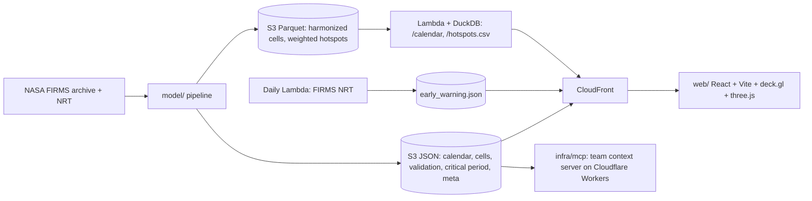

# aeros — project plan

NASA Space Apps Challenge 2026 · Challenge: **Harmonization of MODIS and VIIRS Hot Spots**
Validation region: **Gran Chaco** (Argentina, Paraguay, Bolivia) · Team: Lautaro, David

## 1. Problem

NASA FIRMS has tracked active-fire hotspots since 2000, but the record is split across sensors:

| Platform | Instrument | Pixel | Record | Status (2026-11-14) |
|---|---|---|---|---|
| Terra | MODIS | 1 km | 2000– | orbit drifting; shutdown planned Jan 2027; only morning overpass |
| Aqua | MODIS | 1 km | 2002– | orbit drifting; shutdown planned ~Sep 2027 |
| Suomi NPP | VIIRS | 375 m | 2012-01 – 2026-11-02 | data delivery ceased |
| NOAA-20 / NOAA-21 | VIIRS | 375 m | 2018– / 2023– | active (gaps reported from 2026-11-05) |

VIIRS detects small fires that MODIS misses, so stacking the files makes fire activity "jump" when the fleet changes, not when the fire does. Fire managers cannot tell whether a season was worse or the satellite changed.

## 2. What the challenge asks (brief objectives)

| # | Objective | Where it is covered |
|---|---|---|
| 1 | Harmonize MODIS and VIIRS so the sensor of origin no longer matters | `model/` |
| 2 | Web app: select an area (draw or lat/lon) and a date range | `web/` |
| 3 | Burning activity calendar, month × year, early 2000s to present, accessible color ramp | `web/`, `model/src/aeros/burn_calendar.py` |
| 4 | Anomalies against multi-year history; current month vs historical median | `burn_calendar.py`, `web/` |
| 5 | Downloadable CSV of hotspots and analytics | `web/`, `infra/aws` API |

Only official resource: NASA FIRMS. Raw NASA rows are never shown in the UI, only processed views.

## 3. Approach

1. **Common grid.** Detections binned to H3 resolution 4 (~22 km edge) × ISO week. Location and year are never model features, so models cannot memorize a cell's usual fire load.
2. **Two units.** `hotspots` (detection rows) and `cell_days` (distinct days a cell had fire, which removes most pixel-size inflation).
3. **Continuous VIIRS reference.** Suomi NPP defines the unit; NOAA-20 fills the weeks after 2026-11-02, bridged to SNPP units on their 2018–2026 overlap. Region-wide silent weeks while MODIS sees fire are flagged as data gaps, not zero fire.
4. **Translator MODIS → VIIRS-equivalent**, learned where both flew. Three candidates compete:
   - monthly ratio rule (scales with neighboring MODIS activity where MODIS saw nothing);
   - gradient boosting with Poisson loss;
   - boosting as a correction on top of the ratio rule (trees alone cannot extrapolate).
   A Terra-only variant covers 2000–2002, before Aqua.
5. **Validation.** Leave-one-year-out (picks the winner), out-of-window (later years), spatial hold-out by region. The learned model is used only where it beats the ratio rule.
6. **Uncertainty.** Quasi-Poisson noise plus a systematic term shared by a whole month, estimated on held-out totals, giving 90 % intervals for any area and period.
7. **Calendar analytics.** Leave-one-out same-month median, anomaly and ratio, critical period (shortest run of months holding 80 % of median activity), and the Terra-only morning share and overpass drift.

Synthetic archive with known truth (`python -m aeros demo`):

| Metric | Value |
|---|---|
| Reconstructed pre-VIIRS years, mean yearly error | 5.0 % (raw stacking: 31 %) |
| NOAA-20 bridged weeks, mean yearly error | 7.3 % |
| 90 % interval coverage of yearly totals | 100 % |
| Winner (leave-one-year-out, cell-year MAE) | ratio rule; boosting wins per cell-week |

Real FIRMS numbers replace these once the archive for the region is processed.

## 4. Architecture

| Path | Contents |
|---|---|
| `model/` | Python package `aeros`: FIRMS ingestion, grid, reference chain, translators, validation, calendar, synthetic archive, CLI |
| `web/` | React + Vite + TypeScript client: cinematic intro, H3 map, area selection, calendar, anomalies, CSV export |
| `infra/aws/` | AWS CDK app (TypeScript) and Lambda handlers (Python) |
| `infra/mcp/` | MCP server on Cloudflare Workers + D1: shared status, tasks, decisions and conventions for every assistant on the team |
| `.github/workflows/` | Verification: lint, types, tests, build, `cdk synth` |

**AWS runs inside the Free plan.**
- Lambda Function URLs behind CloudFront instead of API Gateway.
- SSM Parameter Store instead of Secrets Manager.
- DNS stays in Cloudflare.
- No NAT gateways, load balancers, EC2 or customer-managed KMS keys.
- A budget alert at USD 1.
- A CDK test fails on any forbidden resource type.

## 5. Team workflow

- Branches `feature/<kebab-case>` cut from the tip of `develop`, one owner per branch.
- Commits are one logical change each, with an imperative subject, a "why" body and no assistant attribution.
- Rebase on `develop` before review, then push with `--force-with-lease`. Merge locally with `--no-ff` after approval, then delete the branch.
- `main` is production: Lautaro decides each release and tags it with semver.
- Assistants (Claude for Lautaro, Devin and Grok for David) read `git_workflow`, `get_conventions` and `project_status` from the MCP server, and claim a task before touching its files.

## 6. Status and next steps

| Item | State |
|---|---|
| Harmonization model, continuous reference, units, validation, critical period | in `develop` |
| Web app: intro, H3 map, area selection, calendar with coverage labels and critical period, unit toggle, CSV | in `develop` (54 tests) |
| AWS infrastructure inside the Free plan, calendar/CSV API, daily FIRMS refresh with early warning | in `develop` (29 CDK + 63 Lambda tests, `cdk synth` green); not deployed |
| Team context MCP server | deployed at `mcp.aeros.lautaromoreyra.dev` (D1 migrated, `workers.dev` off); behind a Cloudflare Access application (deny by default); people and service tokens are added through Access policies |
| CI | `verify` workflow runs model, web, MCP and AWS checks |
| Study regions (MVP): Gran Chaco (RESOLVE Dry + Humid Chaco), Corrientes, Paraguay | `aeros run --regions all`: one translator fitted on the three, outputs per region in `<out>/<region>/` |
| Detection database | `aeros build-db`: every FIRMS download in one Parquet store by platform and year, time-sorted, deduplicated (standard processing over NRT), with brightness temperatures, unified confidence, cell and region flags; `cell_days` table for ML features; `inventory`, `coverage` (missing days, silent runs) and day-by-day `comparison` reports; `aeros run --db` reads it |
| Real FIRMS archive for the Gran Chaco | to download: yearly country summaries (AR, PY, BO), MODIS C6.1 + VIIRS SNPP + NOAA-20 |
| AWS deploy | pending: account, `cdk bootstrap`, FIRMS MAP_KEY in SSM; reserved concurrency may exceed a new account's limit of 10 |
| Biome as a model feature, Theil–Sen trend | optional |

## 7. Submission checklist (Space Apps)

- [ ] Demo: video up to 30 s or at most 7 slides, public link, in English
- [ ] Link to the deployed app and to this repository
- [ ] Project page: summary, how it works, future vision, tools used
- [ ] Explicit declaration of how AI was used (code assistants, research, translation)
- [ ] List of NASA resources used: FIRMS MODIS C6.1, VIIRS S-NPP and NOAA-20 375 m, NRT
- [ ] All objectives in section 2 verified one by one before submitting
