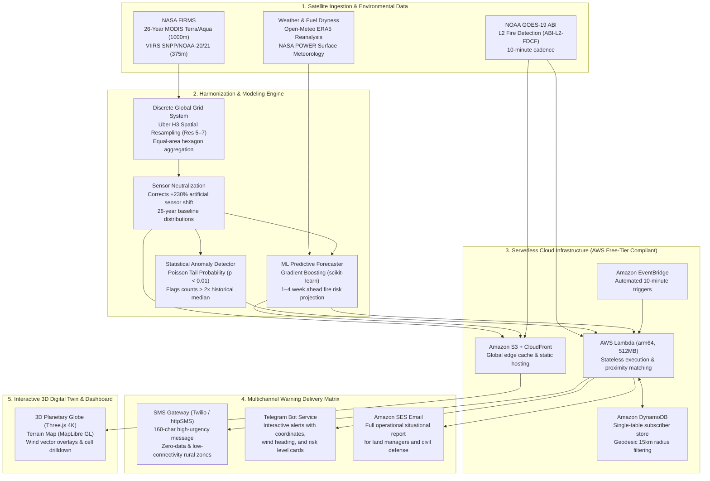
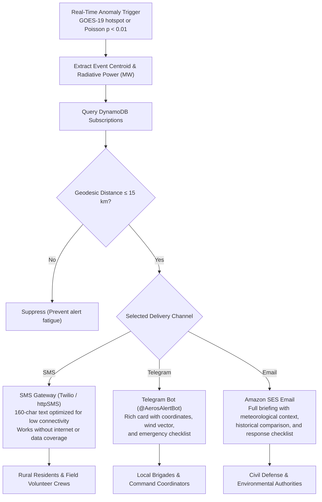
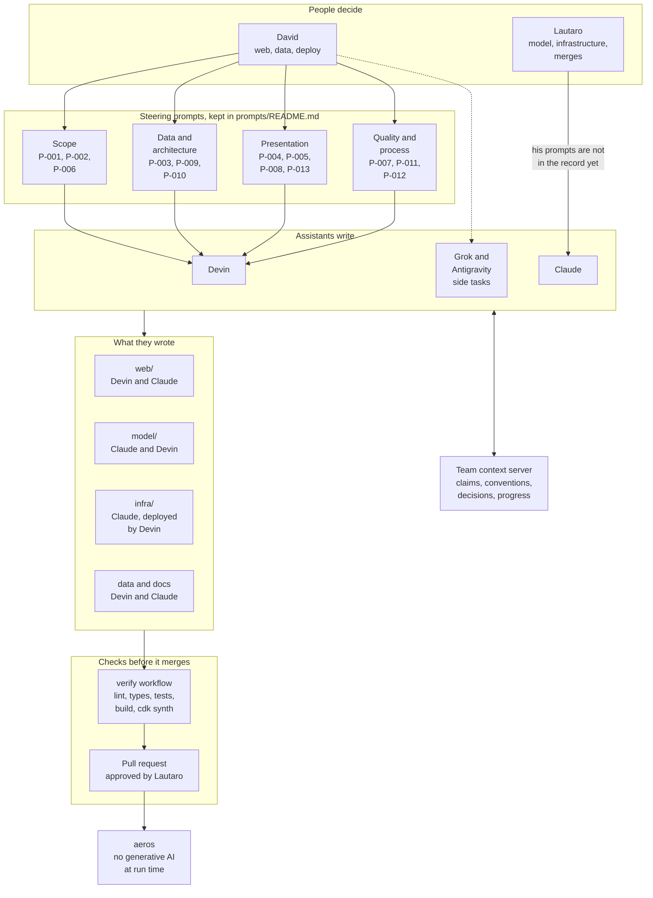

# aeros

Satellite fire early warning, built on 26 years of MODIS and VIIRS hotspots brought onto one scale. NASA FIRMS has recorded fire since 2000, but with sensors that see differently, so the count jumps when the fleet changes and not when the fire does. aeros removes that jump, shows what is normal for any area and month, and warns the people near a possible fire. It runs today on its first study region, in South America; the harmonization never uses location as a model feature, so it is not tied to that region.

- Live: https://aer-os.health
- Challenge: NASA Space Apps Challenge 2026, **Harmonization of MODIS and VIIRS Hot Spots**
- Team: Lautaro and David
- Plan, results and status: [`plan.md`](plan.md)

## What it does

| For | aeros gives |
|---|---|
| Anyone asking whether a season was worse | One harmonized record, 2000 to today, with a 90 % interval for any area and period |
| Fire brigades, land managers, local governments | A calendar of burning activity by month and year, the anomaly against the history, the critical months, and a CSV |
| People who live there | A message by SMS, Telegram or e-mail when an anomalous fire risk is detected near their location |

- **Visual Story Deck**: [`slides/visual-deck.html`](slides/visual-deck.html) (1080p slide deck covering the planetary problem, data crossing, and multi-channel warning matrix)
- **Interactive Pitch Deck**: [`slides/index.html`](slides/index.html)
- **Detailed System Architecture**: [`docs/ARCHITECTURE.md`](docs/ARCHITECTURE.md)
- What is live today and what still waits for a deploy step is in section 6 of [`plan.md`](plan.md).

## Architecture and Data Flow

Aeros integrates 26 years of NASA satellite observations, machine learning risk projections, and AWS serverless computing to deliver early warnings across multiple channels.



### Multichannel Alert Routing

Alert delivery is customized to the user's infrastructure constraints:



## Run it

```bash
# The pipeline on a synthetic archive with known truth
cd model && python -m pip install -e ".[dev]" && python -m aeros demo   # ten to fifteen minutes

# The web app
cd web && npm ci && npm run dev
```

Every pull request runs `.github/workflows/verify.yml` on Python 3.12 and Node 24. Its main checks by hand:

```bash
cd model && ruff check . && python -m pytest -q
cd web && npm ci && npm test && npm run build
cd infra/aws && npm ci && npm run build && npm test && npx cdk synth --quiet
cd infra/mcp && npm ci && npx tsc --noEmit && npx vitest run
```

| Path | Contents |
|---|---|
| `model/` | Python package `aeros`: FIRMS ingestion, grid, reference chain, translators, validation, calendar, command line |
| `web/` | React and TypeScript client: landing page and dashboard |
| `infra/aws/` | AWS CDK stacks and the Python functions behind the API and the alerts |
| `infra/mcp/` | The team context server every assistant reads and writes |
| `prompts/` | The prompts that steered the product |
| `slides/` | Standalone interactive pitch deck and 1080p visual presentation |
| `docs/` | System architecture documentation and visual storytelling assets |

## How AI was used

Two people built aeros, each directing coding assistants. The code, tests and documentation in this repository were written with those assistants; the people decided what to build and checked the result. Lautaro works with Claude. David works with Devin, and used Grok and Antigravity for a few side tasks: connecting the assistants to the team server, the rule that closes each task with its own push, and download scripts that are not in the repository.

The people chose the challenge, the regions, the weather source, the account it runs on and the alert policy, and Lautaro approves every merge.



| Where | What the assistants did | What a person decided or checked |
|---|---|---|
| Choosing the challenge | Compared the challenges on technical demand, room for machine learning, impact and the risk of not finishing (P-001) | The team chose that challenge |
| `model/` | Wrote the pipeline, its tests and the validation runs | The regions (P-002), keeping the whole archive (P-003) and NOAA-21 in the reference chain |
| `web/` | Wrote the landing, the dashboard and the copy | David reviewed in the browser and corrected, down to the facts (P-007) |
| `infra/` | Wrote the stacks, the functions, their tests and the team server, and ran the deploy | The account (P-010), the Free plan limits and the alert policy |
| Data | Downloaded and verified the FIRMS archive | What to keep (P-003) and how long jobs run (P-011); David ordered part of the archive by hand |
| Research and writing | Read NASA, AWS and Google Cloud documentation; wrote commits, pull requests and these documents; turned prompts written in Spanish into English artifacts | Lautaro approves every pull request before it merges |

What to know when reading the history:

- Commits carry no assistant signature, by team convention. Read every commit as written with an assistant.
- Nothing generative runs in the product. The harmonization is a ratio rule corrected by gradient boosting, and the weekly forecast is gradient boosting too (scikit-learn), both trained by the pipeline; the early warning is a statistical test against the same days of earlier years; alert messages are fixed text filled with numbers.
- The assistants coordinate through the team context server: each one claims a task before touching its files and logs what it did.
- The prompts that changed the course are in [`prompts/README.md`](prompts/README.md), each with its situation, the decision and where it landed. The diagram cites them by id.

## Data and credits

| Source | Used for |
|---|---|
| NASA FIRMS: MODIS Collection 6.1 (Terra, Aqua) and VIIRS 375 m (Suomi NPP, NOAA-20, NOAA-21), standard and near real time | The harmonized record and the daily early warning |
| GOES-19 ABI fire product (ABI-L2-FDCF), NOAA Open Data Dissemination | The fire layer that refreshes every 10 minutes and the alert to subscribers |
| Open-Meteo forecast and archive (CC BY 4.0), with ERA5 from Copernicus | Wind and fire weather |
| NASA POWER | Fuel dryness and fire weather in the weekly forecast |
| RESOLVE Ecoregions 2017 (CC BY 4.0) and geoBoundaries | Region outlines |
| NASA Visible Earth (Blue Marble, Black Marble), clouds from Solar System Scope (CC BY 4.0), Esri World Imagery | The globe and the satellite basemap |
