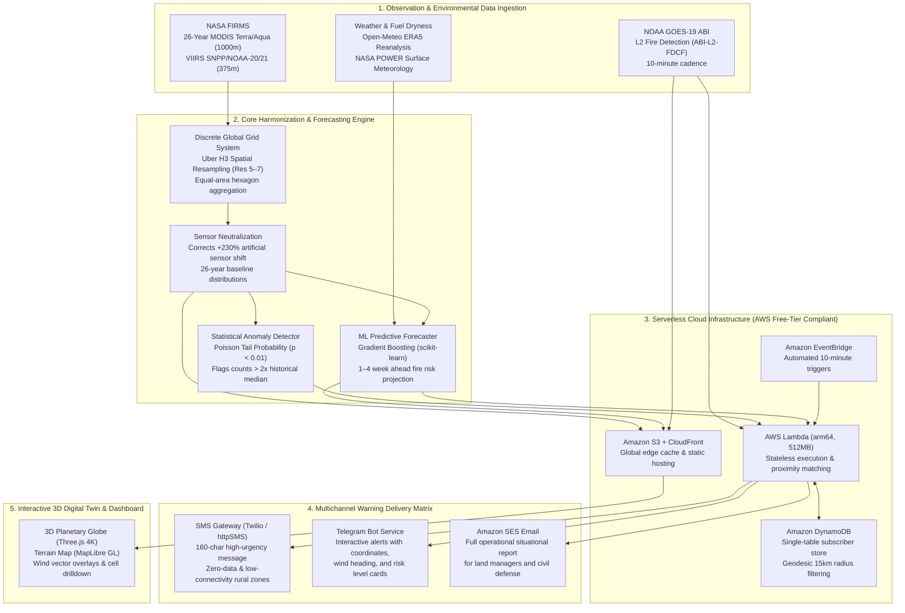
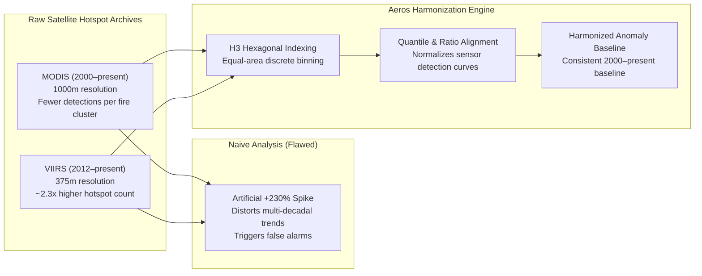
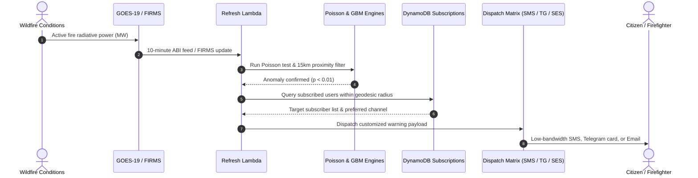
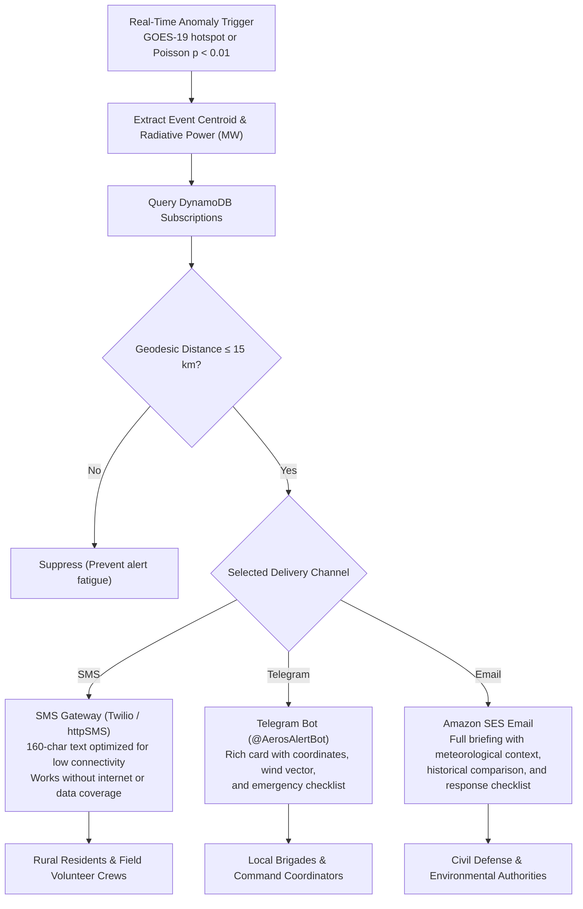
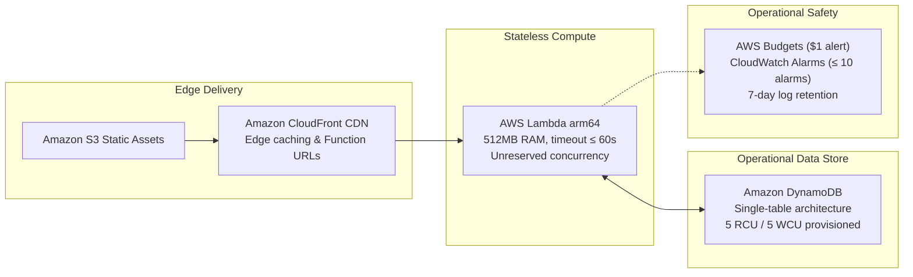

# Aeros System Architecture & Engineering Reference

Aeros is an open, auditable planetary wildfire anticipation and early-warning platform. Built on 26 years of NASA satellite observations (MODIS and VIIRS), it eliminates historical sensor transition artifacts, models multi-horizon fire danger, and dispatches localized alerts to rural communities and emergency responders before flames reach settlements.

---

## 1. End-to-End System Architecture

The end-to-end data lifecycle spans remote-sensing ingestion, equal-area spatial harmonization, statistical anomaly scoring, machine-learning risk projection, serverless cloud routing, and multi-tier notification dispatch.

---

## 2. Sensor Harmonization Pipeline

### The Sensor Transition Problem
NASA FIRMS has tracked global hotspots with MODIS on Terra and Aqua since 2000 at a 1 km spatial resolution. In 2012, VIIRS on Suomi-NPP introduced a finer 375 m imaging channel, followed by NOAA-20 and NOAA-21.

Because VIIRS has ~7 times higher pixel density per unit area, raw active fire counts jump by approximately **+230%** simply from instrument changes. Uncorrected datasets mislead climate models and public response agencies by mistaking sensor evolution for wildfire intensification.

### Aeros Resolution Strategy
1. **H3 Discrete Global Grid System**: Projects hotspot coordinates onto equal-area hexagonal cells (resolution 5 to 7), eliminating projection distortion across latitude ranges.
2. **Empirical Quantile Calibration**: Maps VIIRS detection densities to MODIS-equivalent activity scales using overlapping temporal observations (2012–present).
3. **Location-Agnostic Model**: No geographic identifiers are used as predictive features, ensuring the harmonization methodology transfers universally across ecoregions.

---

## 3. Anticipation Mechanisms

Aeros replaces generative speculation with three auditable, verifiable analytical engines operating across distinct time horizons:

| Horizon | Mechanism | Implementation | Role |
|---|---|---|---|
| **1–4 Weeks** | Gradient Boosting Regressor | `model/src/aeros/forecast.py` | Predicts regional fire pressure using ERA5 weather (2m temperature, relative humidity, wind vectors) and NASA POWER fuel dryness. |
| **Daily Baseline** | Poisson Tail Anomaly Test | `infra/aws/lambdas/refresh/early_warning.py` | Flags when current 7-day activity exceeds $2\times$ historical median with Poisson probability $p < 0.01$. |
| **10 Minutes** | Real-Time Geostationary Watch | `infra/aws/lambdas/refresh/goes_watch.py` | Ingests NOAA GOES-19 ABI Level-2 fire products (ABI-L2-FDCF) for immediate detection. |

---

## 4. Multi-Channel Alert Dispatch Protocol

Wildfire emergencies predominantly affect rural or remote territories where cellular data connectivity is often compromised. Aeros provides a tiered dispatch protocol that routes alerts according to subscriber bandwidth and operational needs.

---

## 5. AWS Cloud Infrastructure & Free-Tier Guardrails

All backend operations are strictly architected to operate within the AWS Free Tier and Always-Free allowances:

* **No Container Gateways**: AWS Lambda Function URLs with CloudFront origin shields eliminate API Gateway overhead.
* **No NAT Gateways or VPCs**: Stateless Lambda functions access AWS service endpoints directly.
* **Single-Table DynamoDB**: Efficient partition indexing on geohash / locality prevents secondary index charges.
* **Deterministic Budgets**: CDK synthesis tests (`infra/aws/test/free-tier.test.ts`) assert template compliance before merge.

---

## 6. Verification and Auditability

The entire codebase is validated across every pull request via `.github/workflows/verify.yml`:
* **Pipeline & Model**: `cd model && ruff check . && python -m pytest -q`
* **Web UI & 3D Twin**: `cd web && npm ci && npm test && npm run build`
* **Infrastructure**: `cd infra/aws && npm ci && npm run build && npm test && npx cdk synth --quiet`
* **Team Server**: `cd infra/mcp && npm ci && npx tsc --noEmit && npx vitest run`
