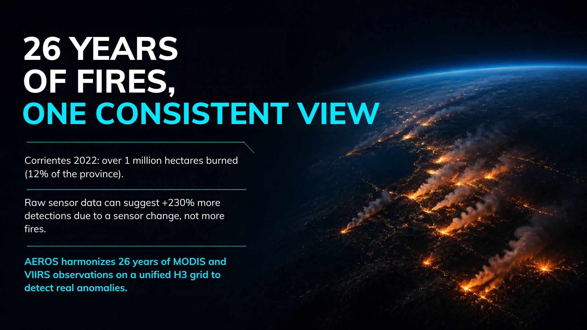
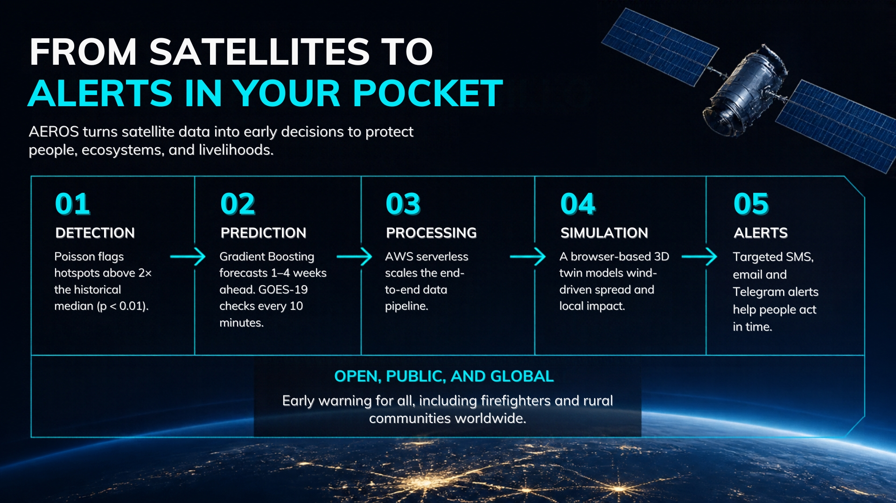
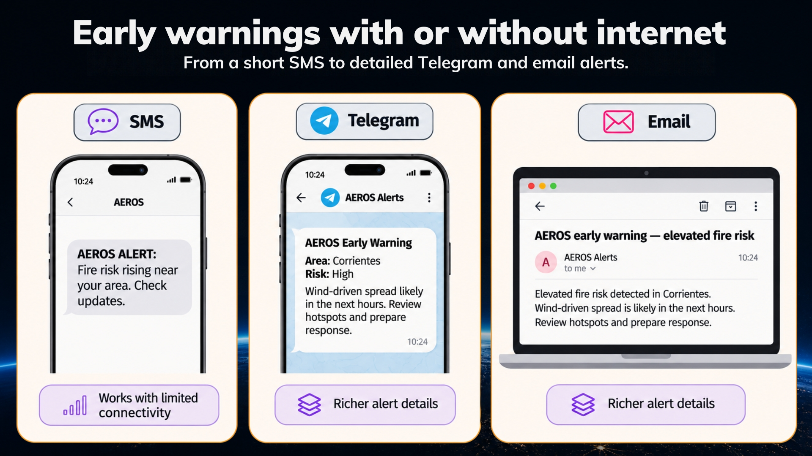

# Aeros · Visual Story Deck & Visual Assets

This folder houses the visual storytelling slides and documentation assets for Aeros. These slides communicate the planetary wildfire anticipation problem, the data harmonization pipeline, and the multi-tier alert dispatch protocol.

The interactive deck is available in browser format at [`slides/visual-deck.html`](../slides/visual-deck.html) or through [`docs/index.html`](index.html).

---

## Slide 1: 26 Years of Fires, One Consistent View
**Theme:** The Planetary Sensor Gap & Problem Statement  
**Visual Asset:** [`docs/1.jpg`](1.jpg) (1920×1080)

### Core Message & Pain Point
* **The Disaster Context:** In Corrientes (Argentina, Summer 2021–2022), severe drought led to catastrophic wildfires burning over 1 million hectares (12% of the province). Citizen crowdfunding and reactive volunteer brigades mobilized only after flames had already reached ranches and towns.
* **The Technical Blindspot:** Satellite fire monitoring across NASA FIRMS spans 26 years (Terra/Aqua MODIS at 1 km resolution since 2000; VIIRS 375 m since 2012). Because VIIRS resolves smaller hotspots, raw counts exhibit an artificial **+230% jump in detections** due to sensor optical sensitivity rather than actual wildfire proliferation.
* **The Aeros Solution:** Aeros projects 26 years of MODIS and VIIRS observations onto a unified, equal-area Uber H3 hexagonal grid, calibrating sensor distributions so public authorities can detect genuine anomalies rather than sensor artifacts.

---

## Slide 2: From Satellites to Alerts in Your Pocket
**Theme:** End-to-End Data Crossing & Predictive Pipeline  
**Visual Asset:** [`docs/2.jpg`](2.jpg) (1920×1080)

### The 5-Stage Architecture Flow
1. **01 Detection (Poisson Tail Anomaly Test):** Identifies active hotspot clusters exceeding $2\times$ the 26-year historical median with statistical significance ($p < 0.01$).
2. **02 Prediction (Gradient Boosting & GOES-19):** Combines historical fire patterns with Open-Meteo ERA5 weather (2m temperature, relative humidity, wind vectors) and NASA POWER fuel dryness to project risk 1–4 weeks ahead. NOAA GOES-19 ABI scans every 10 minutes for immediate detection.
3. **03 Processing (Serverless Cloud Ingestion):** Built entirely on AWS Free-Tier compliant architecture (Lambda arm64 + DynamoDB) without heavy compute overhead.
4. **04 Simulation (Browser-Based 3D Digital Twin):** A photorealistic 4K Earth scene (Three.js) and terrain simulator (MapLibre GL) modeling wind-driven spread and terrain risk.
5. **05 Alerts (Targeted Multichannel Dispatch):** Geodesic 15 km proximity filtering matches detections directly to nearby subscribers.

---

## Slide 3: Early Warnings With or Without Internet
**Theme:** Multi-Tier Warning Delivery Matrix  
**Visual Asset:** [`docs/3.jpg`](3.jpg) (1920×1080)

### Notification Channels by Infrastructure Constraint
Communities and volunteer brigades operating in wildfire corridors experience uneven communications infrastructure. Aeros tailors delivery formats to subscriber connectivity:

| Channel | Format | Best Used For | Sample Message |
|---|---|---|---|
| **SMS** | 160-character plain text | Rural zones, remote pastures, zero-data cellular coverage | `AEROS ALERT: Fire risk rising near your area. Check updates.` |
| **Telegram** | Interactive rich card with coordinates & risk level | Active volunteer firefighters and mobile crews with messaging apps | `AEROS Early Warning · Area: Corrientes · Risk: High · Wind-driven spread likely in the next hours. Review hotspots and prepare response.` |
| **Email** | Structured briefing with weather and tactical guidance | Civil defense coordinators, municipality leaders, and land managers | `AEROS early warning — elevated fire risk · Elevated fire risk detected in Corrientes. Wind-driven spread is likely in the next hours. Review hotspots and prepare response.` |

---

## Interactive Presentation Modes

1. **Standalone Visual Deck**: Open [`slides/visual-deck.html`](../slides/visual-deck.html) in any modern browser. Supports keyboard shortcuts (`Left`, `Right`, `Space`, `F` for Fullscreen, `N` for Speaker Notes).
2. **Integrated Pitch Deck**: Open [`slides/index.html`](../slides/index.html) to view the bilingual presentation deck with direct link to the visual story deck.
3. **Architecture Reference**: See [`docs/ARCHITECTURE.md`](ARCHITECTURE.md) for full engineering and Mermaid diagrams.
