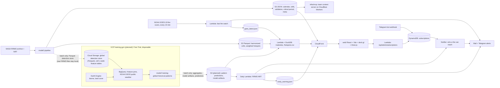

# aeros — project plan

NASA Space Apps Challenge 2026 · Challenge: **Harmonization of MODIS and VIIRS Hot Spots**
Validation region: **Gran Chaco** (Argentina, Paraguay, Bolivia) · Team: Lautaro, David

## 1. Problem

NASA FIRMS has tracked active-fire hotspots since 2000, but the record is split across sensors:

| Platform | Instrument | Pixel | Record | Status (2026-11-14) |
|---|---|---|---|---|
| Terra | MODIS | 1 km | 2000– | orbit drifting; shutdown planned Jan 2027; only morning overpass |
| Aqua | MODIS | 1 km | 2002– | orbit drifting; shutdown planned ~Sep 2027 |
| Suomi NPP | VIIRS | 375 m | 2012-01 – 2026-11-02 | data delivery ceased |
| NOAA-20 / NOAA-21 | VIIRS | 375 m | 2018– / 2023– | active (gaps reported from 2026-11-05) |
| GOES-19 (GOES-East) | ABI | ~2 km | 2025– | active, one full-disk scan every 10 minutes; used only by the fast fire layer, never in the harmonized record |

VIIRS detects small fires that MODIS misses, so stacking the files makes fire activity "jump" when the fleet changes, not when the fire does. Fire managers cannot tell whether a season was worse or the satellite changed.

## 2. What the challenge asks (brief objectives)

| # | Objective | Where it is covered |
|---|---|---|
| 1 | Harmonize MODIS and VIIRS so the sensor of origin no longer matters | `model/` |
| 2 | Web app: select an area (draw or lat/lon) and a date range | `web/` |
| 3 | Burning activity calendar, month × year, early 2000s to present, accessible color ramp | `web/`, `model/src/aeros/burn_calendar.py` |
| 4 | Anomalies against multi-year history; current month vs historical median | `burn_calendar.py`, `web/` |
| 5 | Downloadable CSV of hotspots and analytics | `web/`, `infra/aws` API |

Only official resource: NASA FIRMS. Raw NASA rows are never shown in the UI, only processed views. GOES-19, a public NOAA/NASA GOES-R product, adds a fast layer between polar passes and never enters the harmonized record.

## 3. Approach

1. **Common grid.** Detections binned to H3 resolution 4 (~22 km edge) × ISO week. Location and year are never model features, so models cannot memorize a cell's usual fire load.
2. **Two units.** `hotspots` (detection rows) and `cell_days` (distinct days a cell had fire, which removes most pixel-size inflation).
3. **Continuous VIIRS reference.** Suomi NPP defines the unit; NOAA-20 fills the weeks after 2026-11-02, bridged to SNPP units on their 2018–2026 overlap, and NOAA-21 backs NOAA-20 up through its outages (bridged the same way, from 2023). Region-wide silent weeks while MODIS sees fire are flagged as data gaps, not zero fire.
4. **Translator MODIS → VIIRS-equivalent**, learned where both flew. Three candidates compete:
   - monthly ratio rule (scales with neighboring MODIS activity where MODIS saw nothing);
   - gradient boosting with Poisson loss;
   - boosting as a correction on top of the ratio rule (trees alone cannot extrapolate).
   A Terra-only variant covers 2000–2002, before Aqua.
5. **Validation.** Leave-one-year-out (picks the winner), out-of-window (later years), spatial hold-out by region. The learned model is used only where it beats the ratio rule.
6. **Uncertainty.** Quasi-Poisson noise plus a systematic term shared by a whole month, estimated on held-out totals, giving 90 % intervals for any area and period.
7. **Calendar analytics.** Leave-one-out same-month median, anomaly and ratio, critical period (shortest run of months holding 80 % of median activity), and the Terra-only morning share and overpass drift.

Real FIRMS run, Gran Chaco (14.6 M detections 2000-11 to 2026-11-14 from 607 verified files; chain Suomi NPP -> NOAA-20 -> NOAA-21; unit: hotspots):

| Metric | Ratio rule | Boosting | Boosting on the ratio rule (winner) |
|---|---|---|---|
| Leave-one-year-out MAE, cell-week | 2.80 | 2.80 | **2.63** |
| Leave-one-year-out MAE, cell-year | 58.2 | 59.2 | **52.6** |
| Leave-one-year-out max error of a yearly total | 5.2 % | 4.3 % | **4.2 %** |
| Out-of-window (2020 onward) MAE, cell-week | 3.35 | 3.41 | **3.12** |
| Spatial hold-out MAE, cell-week | 3.15 | 356.7 | **2.89** |

- Plain boosting collapses on unseen regions (it memorizes the training land); boosting as a correction on top of the ratio rule does not, which is why it wins.
- The MODIS -> VIIRS translation misses a VIIRS-observed monthly regional total by 5.1 % (median) and 15 % (90th percentile).
- Raw stacking jumps when VIIRS arrives: stacked rows are about 0.3x the harmonized count in 2002-2011 and 2.2-3.3x from 2018, while the harmonized yearly totals stay in one range.
- After Suomi NPP stopped (2026-11-02) the weeks come from NOAA-20 bridged to Suomi NPP units; the bridge also filled Suomi NPP's 2022-07-27..08-10 outage. NOAA-21 is in the chain but no NOAA-20 outage has needed it yet.
- Critical period (median activity): July to January, peak in August.
- Open: 2001 rests on Terra alone (Aqua from July 2002), so it is the least certain year.

Synthetic archive with known truth (`python -m aeros demo`), kept as a method check: reconstructed pre-VIIRS years 5.0 % mean yearly error (raw stacking 31 %), 90 % interval coverage 100 %.

## 4. Architecture

| Path | Contents |
|---|---|
| `model/` | Python package `aeros`: FIRMS ingestion, grid, reference chain, translators, validation, calendar, synthetic archive, CLI |
| `web/` | React + Vite + TypeScript client: landing page (globe, record on satellite imagery, alert message preview), H3 map, area selection, calendar, anomalies, CSV export |
| `web/design/` | Design reference for the next UI iteration (3D terrain and sector dashboards): the page to open in a browser and the extracted logic and copy. Not part of the build; its numbers are synthetic |
| `infra/aws/` | AWS CDK app (TypeScript) and Lambda handlers (Python) |
| `infra/mcp/` | MCP server on Cloudflare Workers + D1: shared status, tasks, decisions, conventions and the log of steering prompts for every assistant on the team |
| `.github/workflows/` | Verification: lint, types, tests, build, `cdk synth` |

**AWS runs inside the Free plan.**
- Lambda Function URLs behind CloudFront instead of API Gateway.
- SSM Parameter Store instead of Secrets Manager.
- DNS stays in Cloudflare.
- No NAT gateways, load balancers, EC2 or customer-managed KMS keys.
- A budget alert at USD 1.
- A CDK test fails on any forbidden resource type.
- Subscriptions live in one provisioned DynamoDB table (5 of the 25 always-free read and write units, no autoscaling, no backups billed).
- Lambda concurrency is not reserved: a new account keeps 100 executions unreserved and starts with a quota of 10.
- `infra/aws/test/free-tier.test.ts` checks, on the synthesized templates, that no billed or unavailable service appears, DynamoDB stays inside its allowance, alarms stay under ten, every function is arm64 and at most 512 MB, and that the scheduled functions, even if every run lasted its whole timeout, use at most three quarters of the monthly Lambda GB-seconds (GOES watch 4,320 runs at 2 minutes and 0.5 GB is 259,200 of 400,000).
- The Free plan ends after six months or when its credits are spent; the account must then be upgraded, and the USD 1 alert is the early sign.

### Cloud boundary: AWS serves, GCP learns

Big data and machine learning are planned on Google Cloud's Free Trial; AWS keeps the app. No Google Cloud resource exists yet and nothing in the code depends on one.

Data gravity decides placement: each cloud stores only what its own compute reads. Nothing crosses clouds on a request path — only batch artifacts do.

| Side | Owns | Reads | Never does |
|---|---|---|---|
| GCP gym | Global detection store (Parquet), cell x week feature tables, training runs | Cloud Storage, BigQuery public datasets (NOAA GSOD), ERA5 in the public `gcp-public-data-arco-era5` bucket, Earth Engine exports | Serve the app; be required for the app to work; hold raw FIRMS files |
| AWS serving | Harmonized aggregates, model artifacts, pattern predictions, alerts | S3 `DATA_LAYOUT`, Open-Meteo for current weather | Read Cloud Storage or BigQuery per request |

Invariants (enforceable in review):

1. The trained model, its predictions and all aggregates are S3 artifacts — GCP outputs land under `harmonized/` or `derived/` like any pipeline output.
2. Training is re-runnable off GCP: the same `model/` package, and the Parquet store is rebuilt from the raw FIRMS files, which stay local. When the credit expires, retraining degrades to a slower local run, never to zero.
3. The serving path (web, API, alerts) has no GCP dependency — if GCP disappeared today, the app works unchanged.
4. Raw FIRMS files are never uploaded. Only the Parquet store and outputs go to GCP, and only aggregates, model artifacts and predictions go on to AWS.
5. GCP stays inside the `gcp_free_trial` convention: Free Trial only (USD 300, 90 days, never upgraded to a paid account), one project, one US region (us-central1, us-east1 or us-west1), a budget alert at USD 10, CPU-only training. The gym is deleted, not downsized, when the credit runs out.

## 5. Team workflow

- Branches `feature/<kebab-case>` cut from the tip of `develop`, one owner per branch.
- Commits are one logical change each, with an imperative subject, a "why" body and no assistant attribution.
- Rebase on `develop` before review, then push with `--force-with-lease`. Merge locally with `--no-ff` after approval, then delete the branch.
- `main` is production: Lautaro decides each release and tags it with semver.
- Assistants (Claude for Lautaro, Devin and Grok for David) read `git_workflow`, `get_conventions` and `project_status` from the MCP server, and claim a task before touching its files.
- When a prompt from either of us changes what we build or how, the assistant records it with `record_steering_prompt` (the prompt, the situation, the decision, the impact). `steering_study` turns that log into the study for the final presentation.

## 6. Status and next steps

| Item | State |
|---|---|
| Harmonization model, continuous reference, units, validation, critical period | in `develop` |
| Web app: intro, H3 map, area selection, calendar with coverage labels and critical period, unit toggle, CSV | in `develop` (54 tests) |
| Landing page: globe fly-in, H3 columns on Esri World Imagery with this week's flagged cells, WhatsApp and email preview of the early-warning message | on `feature/early-warning-landing`; the preview is UI only, nothing sends WhatsApp or email yet |
| AWS infrastructure inside the Free plan, calendar/CSV API, daily FIRMS refresh with early warning | in `develop` (29 CDK + 63 Lambda tests, `cdk synth` green); not deployed |
| Team context MCP server | deployed at `mcp.aeros.lautaromoreyra.dev` (D1 migrated, `workers.dev` off); behind a Cloudflare Access application (deny by default); people and service tokens are added through Access policies |
| Steering prompt log (`record_steering_prompt`, `steering_study`) | implemented and tested in the MCP server; not deployed |
| CI | `verify` workflow runs model, web, MCP and AWS checks |
| Targeted alerts, subscriptions and Telegram bot | in review on `feature/subscribe-and-notify-by-telegram` (171 Lambda + 49 CDK tests). `subscriptions.py`: double opt-in, a pending sign-up expires after a day, the Telegram chat id is set only by the bot from `/start <id>`, never by the browser. `alerts_api.py`: `POST /api/alerts/subscriptions` (answers 202 with the `https://t.me/<bot>?start=<id>` link for Telegram, e-mails a confirmation link for e-mail), `GET .../{id}/confirm?token=`, `GET .../{id}/unsubscribe?token=` and `DELETE .../{id}?token=`, behind CloudFront; the Telegram webhook is its own public function URL guarded by Telegram's secret header. `notifier.py` runs after the daily early warning and sends each confirmed subscriber the alert for the flagged cells that reach their cells, remembering what was sent only after it went out. A POST or DELETE through CloudFront needs the `x-amz-content-sha256` header (the SHA-256 of the body). Needs the AWS account to run |
| Targeted alerts, risk-zone logic | `infra/aws/lambdas/refresh/targeting.py`: the risk zone of a flagged cell (its ring of neighbors plus the cells downwind, +-30 degrees up to min(80 km, wind km/h x 12 h x 0.1)), which subscribers it reaches, one message per subscriber per window and a resend only when it escalates (more cells, the highest ratio up by half, or the fire weather reaching high or extreme where it had not), and the message text with the fields of the interface's alert plus where the wind is going and how unusual the air is. Pure logic with tests |
| Study regions (MVP): Gran Chaco (RESOLVE Dry + Humid Chaco), Corrientes, Paraguay | `aeros run --regions all`: one translator fitted on the three, outputs per region in `<out>/<region>/` |
| Dashboard sectors: Gran Chaco by country x ecoregion (Bolivian Chaco, Chaco Boreal, Dry Chaco, Humid Chaco) | `sectors.json` in `<out>/gran-chaco/` (also `aeros sectors --out`): each sector a set of H3 cells, no cell counted twice, 99.7 % of the Gran Chaco cells assigned; replaces the web's demo sectors |
| Static web bundle | `aeros publish --run hotspots=<run> [--run cell_days=<run>]`: JSON only, `public/data/<region>/<unit>/`, `<region>/sectors.json`, index `regions.json`, default region also at the old `public/data/<unit>/` path; 8.8 MB for the baseline real run |
| Detection database | `aeros build-db`: every FIRMS download in one Parquet store by platform and year, time-sorted, deduplicated (standard processing over NRT), with brightness temperatures, unified confidence, cell and region flags; `cell_days` table for ML features; `inventory`, `coverage` (missing days, silent runs) and day-by-day `comparison` reports; `aeros run --db` reads it |
| Real FIRMS archive for the Gran Chaco | `aeros fetch`: yearly country summaries (AR, PY, BO) to the last closed year, MODIS C6.1 + VIIRS SNPP + NOAA-20; `aeros fetch-recent` (needs `FIRMS_MAP_KEY`): the current year through the area API, standard processing then NRT, and the whole NOAA-21 record, which the yearly archive does not publish |
| GOES-19 fast fire layer | in `develop`: `aeros goes-latest` writes a snapshot, a Lambda every 10 minutes publishes `derived/goes_latest.json` (served at `/api/active-fires`, 2-minute cache) and alerts through the daily alert's channels when a study cell keeps a confident fire in 2 of the last 3 scans (once per cell, again after 12 hours); not deployed |
| Wind grid | `aeros wind` writes `wind.json`: hourly 10 m wind for the next 48 hours on a 12 x 12 grid over the study box, as the two components `u` (eastward) and `v` (northward) in m/s, from the Open-Meteo forecast API (no key, CC BY 4.0). The interface draws its wind layer from it and the alert's risk zone will read the downwind direction from it; a forecast, never part of the harmonized record. Publishing it hourly from AWS waits for the account |
| Fire weather | `aeros fire-weather` writes `fire_weather.json`: the surface Hot-Dry-Windy index (vapour pressure deficit in hPa times 10 m wind in m/s, highest hour of the day) for the next 4 days on an 8 x 8 grid over the study box, with each node's percentile against the same season of the past 10 years of ERA5, and a level (normal, elevated, high, extreme). Open-Meteo forecast and archive, no key, CC BY 4.0, so the submission credits it. A forecast model is ranked against a reanalysis: read a high rank as unusually dry and windy, not as a measured percentile |
| AWS deploy | ready, waiting for the account: `cdk bootstrap`, `cdk deploy`, the FIRMS MAP_KEY and the Telegram parameters in Parameter Store, the Telegram `setWebhook`, and the model outputs uploaded to the data bucket. Reserved concurrency is off by default so the deploy works on a new account |
| Biome as a model feature, Theil–Sen trend | optional; the biome can come from the Earth Engine export of the GCP gym |
| Global ML gym (GCP) | planned; nothing depends on GCP yet. The boundary is in section 4 and follows the decision "Google Cloud (Free Trial) for big data and ML; AWS keeps the app side". GCP holds what training reads (the global detection store in Parquet, cell x week features, NOAA GSOD via BigQuery, biome via Earth Engine); AWS holds what the app serves; raw FIRMS files stay local. An alert combines the learned pattern, the current NRT reading and the Open-Meteo weather. Steps, claimable in order: (1) global FIRMS archive downloaded locally: the yearly all-countries files 2000-2025 for MODIS, Suomi NPP and NOAA-20 (48 zips, 9.3 GB) into `data/raw/firms-global/`, the last twelve months from Archive Download orders; (2) `aeros build-db` worldwide and the Parquet store uploaded to Cloud Storage; (3) BigQuery feature table cell x week with the weather join; (4) Earth Engine biome export per H3 cell; (5) train in the gym, land the model and its pattern predictions in S3 `derived/`; (6) the NRT refresh reads the predictions — no live GCP call |

## 7. Submission checklist (Space Apps)

- [ ] Demo: video up to 30 s or at most 7 slides, public link, in English
- [ ] Link to the deployed app and to this repository
- [ ] Project page: summary, how it works, future vision, tools used
- [ ] Explicit declaration of how AI was used (code assistants, research, translation)
- [ ] List of NASA resources used: FIRMS MODIS C6.1, VIIRS S-NPP, NOAA-20 and NOAA-21 375 m, NRT; GOES-19 ABI fire product (ABI-L2-FDCF, AWS Open Data) for the fast layer
- [ ] All objectives in section 2 verified one by one before submitting
