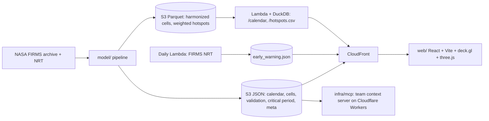

# aeros — project plan

NASA Space Apps Challenge 2026 · Challenge: **Harmonization of MODIS and VIIRS Hot Spots**
Validation region: **Gran Chaco** (Argentina, Paraguay, Bolivia) · Team: Lautaro, David

## 1. Problem

NASA FIRMS has tracked active-fire hotspots since 2000, but the record is split across sensors:

| Platform | Instrument | Pixel | Record | Status (2026-11-14) |
|---|---|---|---|---|
| Terra | MODIS | 1 km | 2000– | orbit drifting; shutdown planned Jan 2027; only morning overpass |
| Aqua | MODIS | 1 km | 2002– | orbit drifting; shutdown planned ~Sep 2027 |
| Suomi NPP | VIIRS | 375 m | 2012-01 – 2026-11-02 | data delivery ceased |
| NOAA-20 / NOAA-21 | VIIRS | 375 m | 2018– / 2023– | active (gaps reported from 2026-11-05) |

VIIRS detects small fires that MODIS misses, so stacking the files makes fire activity "jump" when the fleet changes, not when the fire does. Fire managers cannot tell whether a season was worse or the satellite changed.

## 2. What the challenge asks (brief objectives)

| # | Objective | Where it is covered |
|---|---|---|
| 1 | Harmonize MODIS and VIIRS so the sensor of origin no longer matters | `model/` |
| 2 | Web app: select an area (draw or lat/lon) and a date range | `web/` |
| 3 | Burning activity calendar, month × year, early 2000s to present, accessible color ramp | `web/`, `model/src/aeros/burn_calendar.py` |
| 4 | Anomalies against multi-year history; current month vs historical median | `burn_calendar.py`, `web/` |
| 5 | Downloadable CSV of hotspots and analytics | `web/`, `infra/aws` API |

Only official resource: NASA FIRMS. Raw NASA rows are never shown in the UI, only processed views.

## 3. Approach

1. **Common grid.** Detections binned to H3 resolution 4 (~22 km edge) × ISO week. Location and year are never model features, so models cannot memorize a cell's usual fire load.
2. **Two units.** `hotspots` (detection rows) and `cell_days` (distinct days a cell had fire, which removes most pixel-size inflation).
3. **Continuous VIIRS reference.** Suomi NPP defines the unit; NOAA-20 fills the weeks after 2026-11-02, bridged to SNPP units on their 2018–2026 overlap, and NOAA-21 backs NOAA-20 up through its outages (bridged the same way, from 2023). Region-wide silent weeks while MODIS sees fire are flagged as data gaps, not zero fire.
4. **Translator MODIS → VIIRS-equivalent**, learned where both flew. Three candidates compete:
   - monthly ratio rule (scales with neighboring MODIS activity where MODIS saw nothing);
   - gradient boosting with Poisson loss;
   - boosting as a correction on top of the ratio rule (trees alone cannot extrapolate).
   A Terra-only variant covers 2000–2002, before Aqua.
5. **Validation.** Leave-one-year-out (picks the winner), out-of-window (later years), spatial hold-out by region. The learned model is used only where it beats the ratio rule.
6. **Uncertainty.** Quasi-Poisson noise plus a systematic term shared by a whole month, estimated on held-out totals, giving 90 % intervals for any area and period.
7. **Calendar analytics.** Leave-one-out same-month median, anomaly and ratio, critical period (shortest run of months holding 80 % of median activity), and the Terra-only morning share and overpass drift.

Real FIRMS run, Gran Chaco (14.6 M detections 2000-11 to 2026-11-14 from 607 verified files; chain Suomi NPP -> NOAA-20 -> NOAA-21; unit: hotspots):

| Metric | Ratio rule | Boosting | Boosting on the ratio rule (winner) |
|---|---|---|---|
| Leave-one-year-out MAE, cell-week | 2.80 | 2.80 | **2.63** |
| Leave-one-year-out MAE, cell-year | 58.2 | 59.2 | **52.6** |
| Leave-one-year-out max error of a yearly total | 5.2 % | 4.3 % | **4.2 %** |
| Out-of-window (2020 onward) MAE, cell-week | 3.35 | 3.41 | **3.12** |
| Spatial hold-out MAE, cell-week | 3.15 | 356.7 | **2.89** |

- Plain boosting collapses on unseen regions (it memorizes the training land); boosting as a correction on top of the ratio rule does not, which is why it wins.
- The MODIS -> VIIRS translation misses a VIIRS-observed monthly regional total by 5.1 % (median) and 15 % (90th percentile).
- Raw stacking jumps when VIIRS arrives: stacked rows are about 0.3x the harmonized count in 2002-2011 and 2.2-3.3x from 2018, while the harmonized yearly totals stay in one range.
- After Suomi NPP stopped (2026-11-02) the weeks come from NOAA-20 bridged to Suomi NPP units; the bridge also filled Suomi NPP's 2022-07-27..08-10 outage. NOAA-21 is in the chain but no NOAA-20 outage has needed it yet.
- Critical period (median activity): July to January, peak in August.
- Open: 2001 rests on Terra alone (Aqua from July 2002), so it is the least certain year.

Synthetic archive with known truth (`python -m aeros demo`), kept as a method check: reconstructed pre-VIIRS years 5.0 % mean yearly error (raw stacking 31 %), 90 % interval coverage 100 %.

## 4. Architecture

| Path | Contents |
|---|---|
| `model/` | Python package `aeros`: FIRMS ingestion, grid, reference chain, translators, validation, calendar, synthetic archive, CLI |
| `web/` | React + Vite + TypeScript client: cinematic intro, H3 map, area selection, calendar, anomalies, CSV export |
| `infra/aws/` | AWS CDK app (TypeScript) and Lambda handlers (Python) |
| `infra/mcp/` | MCP server on Cloudflare Workers + D1: shared status, tasks, decisions, conventions and the log of steering prompts for every assistant on the team |
| `.github/workflows/` | Verification: lint, types, tests, build, `cdk synth` |

**AWS runs inside the Free plan.**
- Lambda Function URLs behind CloudFront instead of API Gateway.
- SSM Parameter Store instead of Secrets Manager.
- DNS stays in Cloudflare.
- No NAT gateways, load balancers, EC2 or customer-managed KMS keys.
- A budget alert at USD 1.
- A CDK test fails on any forbidden resource type.

## 5. Team workflow

- Branches `feature/<kebab-case>` cut from the tip of `develop`, one owner per branch.
- Commits are one logical change each, with an imperative subject, a "why" body and no assistant attribution.
- Rebase on `develop` before review, then push with `--force-with-lease`. Merge locally with `--no-ff` after approval, then delete the branch.
- `main` is production: Lautaro decides each release and tags it with semver.
- Assistants (Claude for Lautaro, Devin and Grok for David) read `git_workflow`, `get_conventions` and `project_status` from the MCP server, and claim a task before touching its files.
- When a prompt from either of us changes what we build or how, the assistant records it with `record_steering_prompt` (the prompt, the situation, the decision, the impact). `steering_study` turns that log into the study for the final presentation.

## 6. Status and next steps

| Item | State |
|---|---|
| Harmonization model, continuous reference, units, validation, critical period | in `develop` |
| Web app: intro, H3 map, area selection, calendar with coverage labels and critical period, unit toggle, CSV | in `develop` (54 tests) |
| AWS infrastructure inside the Free plan, calendar/CSV API, daily FIRMS refresh with early warning | in `develop` (29 CDK + 63 Lambda tests, `cdk synth` green); not deployed |
| Team context MCP server | deployed at `mcp.aeros.lautaromoreyra.dev` (D1 migrated, `workers.dev` off); behind a Cloudflare Access application (deny by default); people and service tokens are added through Access policies |
| Steering prompt log (`record_steering_prompt`, `steering_study`) | implemented and tested in the MCP server; not deployed |
| CI | `verify` workflow runs model, web, MCP and AWS checks |
| Study regions (MVP): Gran Chaco (RESOLVE Dry + Humid Chaco), Corrientes, Paraguay | `aeros run --regions all`: one translator fitted on the three, outputs per region in `<out>/<region>/` |
| Dashboard sectors: Gran Chaco by country x ecoregion (Bolivian Chaco, Chaco Boreal, Dry Chaco, Humid Chaco) | `sectors.json` in `<out>/gran-chaco/` (also `aeros sectors --out`): each sector a set of H3 cells, no cell counted twice, 99.7 % of the Gran Chaco cells assigned; replaces the web's demo sectors |
| Static web bundle | `aeros publish --run hotspots=<run> [--run cell_days=<run>]`: JSON only, `public/data/<region>/<unit>/`, `<region>/sectors.json`, index `regions.json`, default region also at the old `public/data/<unit>/` path; 8.8 MB for the baseline real run |
| Detection database | `aeros build-db`: every FIRMS download in one Parquet store by platform and year, time-sorted, deduplicated (standard processing over NRT), with brightness temperatures, unified confidence, cell and region flags; `cell_days` table for ML features; `inventory`, `coverage` (missing days, silent runs) and day-by-day `comparison` reports; `aeros run --db` reads it |
| Real FIRMS archive for the Gran Chaco | `aeros fetch`: yearly country summaries (AR, PY, BO) to the last closed year, MODIS C6.1 + VIIRS SNPP + NOAA-20; `aeros fetch-recent` (needs `FIRMS_MAP_KEY`): the current year through the area API, standard processing then NRT, and the whole NOAA-21 record, which the yearly archive does not publish |
| Wind grid | `aeros wind` writes `wind.json`: hourly 10 m wind for the next 48 hours on a 12 x 12 grid over the study box, as the two components `u` (eastward) and `v` (northward) in m/s, from the Open-Meteo forecast API (no key, CC BY 4.0). The interface draws its wind layer from it and the alert's risk zone will read the downwind direction from it; a forecast, never part of the harmonized record. Publishing it hourly from AWS waits for the account |
| Fire weather | `aeros fire-weather` writes `fire_weather.json`: the surface Hot-Dry-Windy index (vapour pressure deficit in hPa times 10 m wind in m/s, highest hour of the day) for the next 4 days on an 8 x 8 grid over the study box, with each node's percentile against the same season of the past 10 years of ERA5, and a level (normal, elevated, high, extreme). Open-Meteo forecast and archive, no key, CC BY 4.0, so the submission credits it. A forecast model is ranked against a reanalysis: read a high rank as unusually dry and windy, not as a measured percentile |
| AWS deploy | pending: account, `cdk bootstrap`, FIRMS MAP_KEY in SSM; reserved concurrency may exceed a new account's limit of 10 |
| Biome as a model feature, Theil–Sen trend | optional |

## 7. Submission checklist (Space Apps)

- [ ] Demo: video up to 30 s or at most 7 slides, public link, in English
- [ ] Link to the deployed app and to this repository
- [ ] Project page: summary, how it works, future vision, tools used
- [ ] Explicit declaration of how AI was used (code assistants, research, translation)
- [ ] List of NASA resources used: FIRMS MODIS C6.1, VIIRS S-NPP, NOAA-20 and NOAA-21 375 m, NRT
- [ ] All objectives in section 2 verified one by one before submitting
